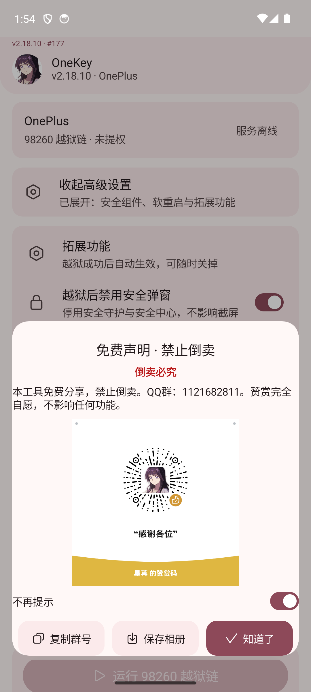
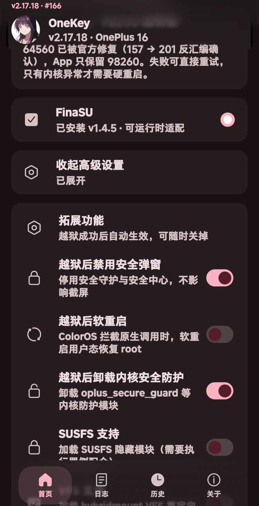
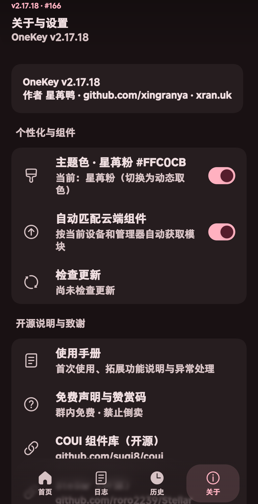

<div align="center">

# OneKey

**一加 16 / Ace 7 Pro 本地越狱工具 · ColorOS 17 适配**

[](./LICENSE)
[](https://github.com/xingranya/onekeyjb/releases)
[]()
[]()
[](https://developer.android.com/jetpack/compose)
[]()
[](https://github.com/xingranya/onekeyjb/actions/workflows/android.yml)

</div>

---

## 这是什么

OneKey 是一个运行在 Android 上的**本地越狱辅助工具**：通过公开的内核漏洞获取临时 root，再把你自己安装的 root 管理器（KernelSU 系）拉起来。

- 全程本地执行，不联网、不上传数据
- 不内置管理器本体，运行时读取你已安装的管理器 APK 与其 `libksud`
- 重启后 root 失效属正常，再点一次即可

## 截图

<div align="center">
  
  
  
</div>

## 功能

| 功能 | 说明 |
| --- | --- |
| 一键越狱 | 首页点一次，约 3 秒拿到 root（`su` 可用，SELinux 保持 Enforcing） |
| 失败可重试 | 只有真的写入内核才提示重启；未写入可直接再点 |
| 管理器热切换 | 已越狱的设备可在五家管理器之间切换，不重启、不重新越狱（需内核模块提供 /proc/kernelsu_manager） |
| 五个拓展功能 | 禁用安全弹窗、软重启、卸载内核安全防护、SUSFS、VFS |
| 日志可追溯 | 每行日志实时落盘，软重启或被杀后重开仍能回看上次记录 |
| 管理器自适应 | KernelSU / KernelSU-Next / SukiSU Ultra / BakaSU / FinaSU |
| 用户协议 | 首次启动强制阅读 10 秒并滚动到底部才能同意 |

## 支持机型

| 机型 | 系统 / 内核 | 状态 |
| --- | --- | --- |
| 一加 16（PYB110） | ColorOS 17.0.1.201 · `6.18.21-…-g7fcbffcad3e1` | ✅ 真机实测跑通 |
| 一加 16（PYB110） | ColorOS 17.0.0.x · `6.18.21-…-gf957accaf563` | ✅ 档案保留 |
| 一加 Ace 7 Pro（PMS110） | `6.12.69-android16` | ⚠️ 档案保留，本版未重新验证 |

> 系统 OTA 会更换内核，适配档案需要跟着更新；不匹配时应用会明确提示"当前设备或内核不支持"，不会盲跑。

## 使用步骤

1. 安装并打开管理器（KernelSU 系任一），先不要求 root
2. 启动 Stellar 或 Shizuku 服务，回到 OneKey 授予权限
3. 首次启动阅读并同意《用户协议与免责声明》
4. 首页点「运行 98260 越狱链」，等待进度到 100%
5. 用 `su -c id` 验证；重启后需要重新执行

## 从源码构建

```bash
# 需要 JDK 21、Android SDK 37、NDK 29
cd merged-app
./gradlew assembleRelease
# 产物：app/build/outputs/apk/release/app-release.apk
```

仓库自带 GitHub Actions（`.github/workflows/android.yml`），push 或手动触发即会构建并产出 APK 工件。

原生执行器（可选，自研链路）单独编译：

```bash
cd native/executor
$NDK/toolchains/llvm/prebuilt/*/bin/aarch64-linux-android33-clang -O2 -o onekey-exec main.c leak.c
```

## 目录结构

```
merged-app/        Android 工程（Compose UI + 执行器桥接）
native/executor/   自研执行器源码（泄漏 / 占位阶段）
knowledge/         技术文档（内核适配、链路分析、执行引擎协议）
docs/              研究记录与截图
artifacts/         发布产物（APK、update.json、云端模块）
tools/             签名与模块处理脚本
```

## 第三方与致谢

完整清单（组件、作者、许可证、上游地址）见 [THIRD_PARTY_NOTICES.md](./THIRD_PARTY_NOTICES.md)。

特别致谢：**KSU-Universal（Yunnijian）**、**SUSFS（susfs4ksu）**、**Hybrid Mount（maxsteeel）**、**KernelSU / KernelSU-Next / SukiSU Ultra / BakaSU / FinaSU**、**COUI（suqi8）**、**Stellar（roro2239）**、**Shark**、**onuce**、**InfinityCore**。

其中内核模块与执行引擎为 GPL 许可，源码可从上游获取；本应用未修改模块逻辑，仅按内核版本重编译并对齐 vermagic。

## 免责声明

越狱、刷机、加载内核模块属于高风险操作，可能导致设备无法开机、数据丢失、保修失效或部分应用不可用。
**风险由使用者自行承担**，作者不对任何直接或间接损失负责。

同时禁止以本项目名义骚扰、攻击手机厂商或系统团队及其官方渠道，禁止冒充官方；由此产生的责任由行为人自负。
请在完全理解风险后使用，并遵守所在地法律法规。

## 许可证

本项目以 **GNU General Public License v3.0** 发布，见 [LICENSE](./LICENSE)。

<div align="center"><sub>Made with ❤️ for OnePlus · OneKey</sub></div>